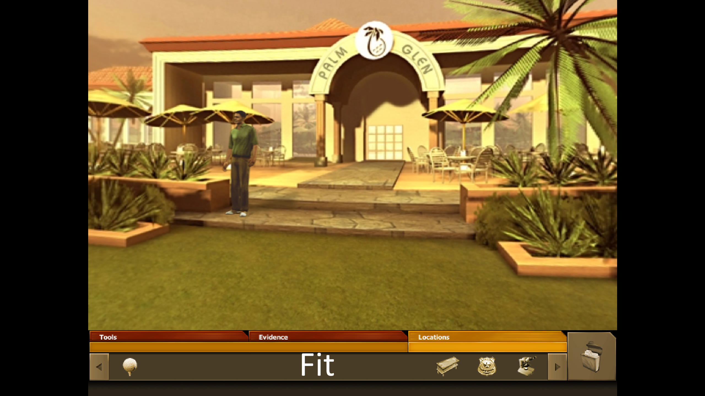
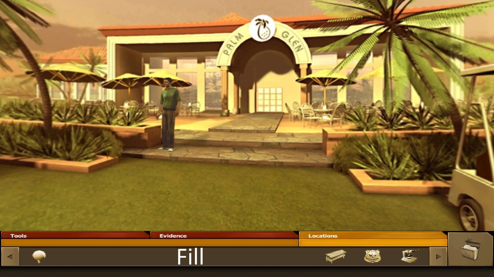

# CSI: Miami AiO Fix

**Made by Tiger Fury**

Compatibility fixes for the original PC release of **CSI: Miami**, available in three presentations. A full game installation is required.

| Download | Presentation |
| --- | --- |
| [Original](https://github.com/Tiger-Fury/CSI-Miami-AiO-Fix/releases/download/v1.0.0/CSI-Miami-Original-v1.0.0.zip) | Original 800×600 presentation using the original executable and corrected shared files. |
| [Fit](https://github.com/Tiger-Fury/CSI-Miami-AiO-Fix/releases/download/v1.0.0/CSI-Miami-Fit-v1.0.0.zip) | Scales to the desktop while preserving 4:3 proportions, with borders where needed. |
| [Fill](https://github.com/Tiger-Fury/CSI-Miami-AiO-Fix/releases/download/v1.0.0/CSI-Miami-Fill-v1.0.0.zip) | Stretches the complete picture across the desktop without cropping the interface. |

## Screenshots

### Fit

Preserves the original 4:3 proportions with borders.



### Fill

Stretches the complete picture across the desktop.



## Fixes

- Loads case content from the full local installation without repeated CD checks. Paths follow the installation folder; no drive letter is hard-coded.
- Corrects modern graphics-driver path handling in the Shockwave runtime.
- Uses the existing frame-by-frame Bink playback path for affected loading, location, intro and logo videos, addressing blocky/flickering video and overlap with the scene behind it.
- Includes the established DirectX render-target and presentation corrections. Oversized internal DirectX targets are capped while the final picture can still fill the desktop.
- Fit and Fill detect the primary desktop resolution at launch and retain the original logical game coordinates.

Original, Fit and Fill were reported working by the tester in this project. Miami no-CD, loading videos, cutscenes and rendering were also confirmed working. This is user-reported gameplay validation, supplemented by hash checks, bytecode/layout checks and independent decompilation. Compatibility across every PC, driver and Windows version is not claimed; Windows 10 has not been independently tested here.

## Installation

1. Close the game and back up the matching files in its installation folder.
2. Download the presentation you want and extract it.
3. Copy the supplied EXE/INI files, `Framework` and `xtras` into the game folder. Merge folders and replace matching files.
4. Launch `CSI-Miami.exe`, `CSI-Miami-Fit.exe` or `CSI-Miami-Fill.exe`, depending on the package.

All three packages use **identical shared Library and renderer files**, so they can be installed together. Keep the existing game data and `Lingo.ini`. No Shockwave web-player download, Python installation or diagnostic tool is needed to play.

The Original package uses the original executable byte-for-byte; its fixes are in the shared files. Fit and Fill include modified bootstrap executables. The fix does not relocate saves, replace artwork, alter language packs or include the unfinished filtering/sharpening experiments.

## Switching modes and rollback

Choose another launcher to switch presentation. To remove the shared fixes, close the game and extract the included `Rollback-original-shared-files.zip` into the installation. It restores the original Library and Shockwave renderer. Use the original `CSI-Miami.exe` afterwards. Keep backups of any pre-existing customised files: the included rollback targets the verified original build, not arbitrary earlier mods.

## Source and reproducibility

The repository contains the patch builder and byte-level patch manifests, rather than complete proprietary game files. Supply a matching **unmodified** installation to rebuild the three packages locally:

```powershell
python build.py --game "C:\Games\CSI-Miami" --output "C:\Builds\CSI-Miami-fixes"
```

Python 3.10 or newer is required only for rebuilding. The builder validates all original input hashes, writes into a separate new output folder, and never executes or modifies the installed game. Already-patched or different game versions are rejected. `build.py --help` lists the options.

The patch-builder code is MIT licensed. Original game data, runtime components, game names and trademarks belong to their respective owners; that licence does not relicense them. Release downloads contain the modified files needed to install the fix, not the full game.
